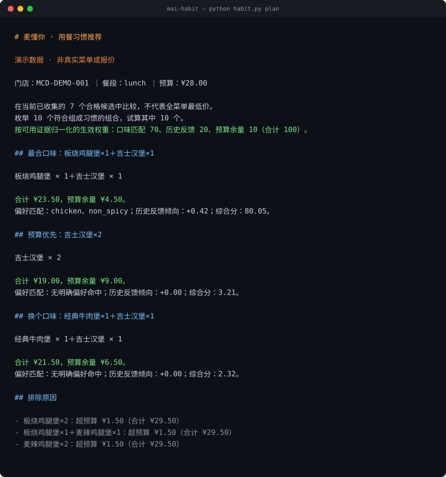
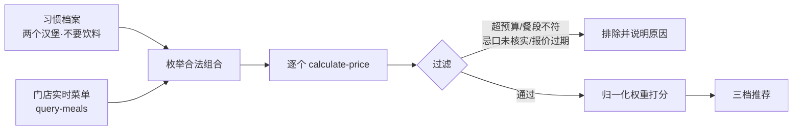

<div align="center">

# 麦懂你

**你的吃法说一次，之后每次都在真实菜单和优惠里替你重算一遍。**

固定要两个汉堡、套餐里的饮料不喝、预算 28 元 —— 这些不是"猜你喜欢"的标签，是硬约束。

[](#)
[](#)
[](#验证)
[](LICENSE)

**[▶ 在线试玩](#在线试玩)** ｜ **[30 秒上手](#三十秒跑起来)** ｜ **[它怎么排的](#打分怎么来的)** ｜ **[只读边界](#边界)**

<!-- 推上 GitHub 后，可把上面的 Tests 徽章换成 Actions 页面给你的实时 CI 徽章地址。 -->



</div>

> 上图由 `python habit.py plan` 真实输出渲染，可用 `tools/render_screenshot.py` 复现。

## 给谁用

有固定选餐习惯、但每次都要在几十个 SKU 里反复划手机的人。

最典型的一种：**只想买两个汉堡，饮料自己另外买。** 套餐几乎都绑着可乐，单点又没有优惠，于是每次点餐都要重新算一遍"单点两个汉堡"和"套餐去掉饮料"哪个划算。麦懂你把这个过程变成一句常驻条件。

## 它和"猜你喜欢"有什么不同

| | 常规推荐 | 麦懂你 |
|---|---|---|
| 输入 | 你的历史行为，推断出来的 | 你明确说过的组成条件 |
| 两个汉堡 | 可能被当成"想多吃"的异常偏好 | 硬约束：一份汉堡的组合根本不进入候选 |
| 不喝饮料 | 套餐都带可乐，只能每次手动去掉 | `drink: max=0`，含饮料的组合不会被枚举出来 |
| 价格 | 菜单标价相加 | 每个组合单独调用 `calculate-price` 试算，含优惠 |
| 为什么推它 | 黑盒 | 给出分数拆解；**没被选中的，也给出排除原因** |

## 在线试玩

不想装任何东西：打开 [`docs/index.html`](docs/index.html)，左边改条件（几份主食、要不要饮料、预算、口味），右边实时出推荐和逐条排除原因。

**https://pha1aris.github.io/mai-habit/**（GitHub Pages，Settings → Pages 选 `main` 分支的 `/docs` 目录）。不开 Pages 也能用：直接打开仓库里的 [`docs/index.html`](docs/index.html)，不联网都能跑。

几点说明，避免误解：

- **同一套算法。** 演示页是 `docs/index.html` 里的纯 JavaScript，枚举规则照搬 `planner.py`，打分照搬 `recommender.py`。CI 里的 `demo-parity` 会逐个比对两边的组合列表，不一致就红。
- **口径不同。** 演示页用**菜单标价**做保守估算；命令行走 `calculate-price` 拿的是含优惠的实付价。所以同一组合在真实试算里可能更便宜，也可能因此多几个候选进预算。拿标价相加冒充实付价，正是本项目不做的事。
- **数据是虚构的。** 门店、菜单、价格全部虚构，用于展示行为，不代表任何真实门店。

## 三十秒跑起来

无需 Token、无需第三方依赖、Python 3.10+。clone 或下载本仓库后，进入目录：

```bash
cd mai-habit

# 1. 先看推荐长什么样（内置虚构菜单，不改你的任何东西）
python habit.py demo

# 2. 记录你自己的习惯，之后每次点餐都按它算
python habit.py init
#    一餐要几份主食？[2]
#    要不要搭配饮料？[y/N]
#    这一餐预算多少元？[30]
#    固定的口味偏好（可留空）：

# 3. 走完整链路：门店菜单 → 枚举组合 → 逐个计价 → 排序
python habit.py plan \
  --profile private/profile.json \
  --menu    examples/replay/menu.json \
  --prices  examples/replay/prices.json \
  --mapping examples/replay/mapping.json \
  --meal lunch --store MCD-DEMO-001
```

第 3 步和接入真实服务走的是**同一套代码路径**，只是把网络响应换成了仓库里的脱敏样本。第 2 步记下的预算会成为默认值，`--budget` 可以省略。

**为什么第 2 步不能省：** 仓库里自带的 `examples/profile.json` 是「两个汉堡、不含饮料」的示例，不是你的习惯。如果直接拿它跑，得到的是一份按别人条件算出来的推荐——那正是这个项目想避免的事。所以示例档案带 `"source": "example"` 标记，用到它时会明确提醒你一次。

两个容易被忽略的兼容性细节：

- **中文 Windows 控制台（cp936）不会因为打印 `¥` 崩掉。** 重定向到文件时自动切到 UTF-8；交互式控制台保留原编码，只把符号退回同样含义的 `￥`。
- **首屏那张图是 CI 校验过的。** `tools/render_screenshot.py` 输出确定，CI 会重新渲染并与 `docs/terminal.svg` 逐字节比对，所以截图不会和代码脱节。

## 内部流程



三个刻意为之的设计：

1. **枚举阶段就不生成违规组合**，而不是生成一堆再删掉——省下的是真实 API 调用额度。
2. **不拿菜单标价相加当总价**。组合的真实应付金额只来自 `calculate-price`；标价只用来给请求量做粗筛。
3. **报价 15 分钟失效**。超过就报错让你重新试算，不拿旧价格继续推荐。

## 一次推荐花几次请求

不装依赖，也要守住调用额度。实时模式下，一次 `plan` 的请求数是 **N + 3**，不是 `2N + 3`：

| 环节 | 请求数 |
|---|---|
| `initialize` + `notifications/initialized` | 2 |
| `tools/list`（整个会话只拉一次） | 1 |
| 每个候选一次 `calculate-price` | N |

之前每次 `tools/call` 前都重新拉一遍工具列表来读 `inputSchema`，40 个候选就白花 40 次请求。工具目录现在缓存在 `Client` 里，只有显式 `refresh` 才重拉。

另外三条与额度有关的取舍：

- **计价串行，不并发。** 并发很容易撞上限流，省下的几秒不值得整轮失败。
- **`--max-quotes` 限制试算上限**（默认 40）。被跳过多少会直接写进输出，不静默截断。
- **429 / 5xx 有限重试**（最多 2 次，指数退避，遵守 `Retry-After`）。只重试读工具，所以重试不会重复下单——本项目根本不下单。

## 打分怎么来的

基线公式：

```
得分 = 70 × 明确口味匹配比例 + 20 × 平滑历史反馈倾向 + 10 × 预算余量比例
```

但**没有证据的维度会被摘掉，再把剩下的权重归一化到 100**：

| 你的档案状态 | 实际生效权重 | 排序的真实含义 |
|---|---|---|
| 只说了"两个汉堡、不要饮料" | 预算 100 | 价格最低优先 |
| 再加上"喜欢鸡肉、不辣" | 口味 87.5 + 预算 12.5 | 先命中标签，同分看价格 |
| 再加上点过赞 / 点过不喜欢 | 口味 70 + 反馈 20 + 预算 10 | 越吃越懂你 |

这一条是针对一类常见的假个性化：**冷启动时仍挂着 70 分的口味权重，虽然它恒为 0，输出看起来却像"个性化推荐"，实际上就是价格排序。** 这里会直接告诉你：当前没有口味记录，只看预算。

同理，"最合口味"这个标签只在真有候选命中你的标签时才会出现；一旦全部命中候选都超预算，它会降级成"预算内可选"，而不是换个说法继续骗你。

## 它会明确告诉你"没有"

预算压到 25 元时，所有纯鸡肉组合都超预算：

```text
## 预算内可选：吉士汉堡×2

吉士汉堡 × 2

合计 ¥19.00，预算余量 ¥6.00。
偏好匹配：无明确偏好命中；历史反馈倾向：+0.00；综合分：2.40。

## 排除原因

- 板烧鸡腿堡×2：超预算 ¥4.50（合计 ¥29.50）
- 板烧鸡腿堡×1＋麦辣鸡腿堡×1：超预算 ¥4.50（合计 ¥29.50）
```

它不会偷偷放宽"两个汉堡"、不会把饮料塞回来、也不会把超预算的组合混进推荐。

## 它是怎么记住习惯的

第一件事是问你，而不是猜你。`init` 逐项问清组成、预算、口味和忌口，写进私有档案；留空就采用括号里的默认值，但那也是你点了头的结果。

```bash
# 交互式：一项一项问，留空用默认值
python habit.py init

# 非交互式：给智能体或脚本用，等价于同样的档案
python habit.py init --burger 2 --drink none --budget 25 --tags chicken,non_spicy
```

```json
{
  "source": "user",
  "created_at": "2026-10-24T10:55:17+08:00",
  "category_limits": {
    "burger": {"min": 2, "max": 2},
    "drink":  {"max": 0}
  },
  "preferred_tags": ["chicken"],
  "avoid_tags": [],
  "feedback": {},
  "default_budget_cents": 2500
}
```

之后只在你**明确表达**时才追加记录：

```bash
# 用户明说"今天这个板烧不错"之后，才记录
python habit.py feedback --profile private/profile.json --meal lunch --tags chicken,non_spicy --rating like
```

要点：

- **`source` 区分「你说的」和「示例里的」。** `example` 会在运行时被提醒，`user` 才是你自己的习惯；没有这个字段的档案一律按示例对待。
- **`init` 不会覆盖已有档案**，除非显式 `--force`。档案写在 `private/` 下，权限 600。
- 反馈按 `breakfast / lunch / dinner` 分开统计，早餐的偏好不会污染晚餐。
- **"推荐过"不等于"吃过"。** 只有用户明确点赞/不喜欢才进历史。
- 档案是一个可读可改可删的 JSON，不藏数据库。

## 接入真实麦当劳 MCP

在[开放平台](https://open.mcd.cn/mcp)申请 Token，放进环境变量（不要写进源码、截图或公开仓库）：

```bash
export MCD_MCP_TOKEN='<your-token>'
python habit.py mcp-tools     # 先看服务真实提供的工具与 inputSchema
```

然后按真实结构填好 mapping，去掉 `--prices` 即为实时：

```bash
python habit.py plan \
  --profile private/profile.json \
  --menu    private/menu-response.json \
  --mapping private/mapping.json \
  --meal lunch --budget 30 --store <门店编号>
```

### 为什么会有一个 mapping 文件

**这是本项目的核心取舍：不去猜 API 字段名。**

麦当劳 MCP 的返回结构会随版本变化。与其硬编码一套猜测的字段名、在字段变化时静默产出错误结果，不如把映射显式写出来，对不上就直接报错。

```json
{
  "menu": {
    "list": "categories.*.items.*",
    "price_unit": "yuan",
    "fields": {
      "code": "productCode", "name": "productName",
      "category": "categoryName", "price": "price",
      "tags": "tasteTags", "available": "saleStatus"
    }
  },
  "price_request": {
    "storeCode": "${store_id}",
    "items": "${items}",
    "itemTemplate": {"productCode": "${code}", "quantity": "${quantity}"}
  },
  "quote": {"total_cents": "payPrice"}
}
```

- `categories.*.items.*` —— 点路径，`*` 用于展开数组
- `${...}` —— 计价请求模板占位符，整段占位符会保留原 JSON 类型
- 中文类目名（汉堡 / 饮料 / 小食）会自动归一到 `burger / drink / side`

## 数据与验证状态

这一节是硬话，因为项目里出现的每个价格都该有出处：

- `examples/replay/*` 是**虚构样本**，不是麦当劳真实菜单或报价。
- 本项目**尚未使用真实 Token 完成生产联调**，因此演示结果不能用来证明真实价格准确。
- MCP 调用链本身已完整实现并有测试覆盖：初始化握手、工具发现与分页、JSON/SSE 双响应、只读工具白名单、按实时 `inputSchema` 校验参数。
- 换句话说：演示能证明**逻辑正确、链路完整、可复现**；不能证明**某个门店某个时刻的真实价格**。

## 边界

- **只读。** 客户端白名单只放行 8 个查询与计价工具，`create-order`、`cancel-order`、`auto-bind-coupons` 等写操作在代码层被拒绝。白名单是**策略**，在读取 Token 之前就生效：没配 Token 时请求写工具，报的是"不在范围内"，而不是"缺凭证"——否则真实原因会被掩盖，且换个入口（直接调 `client.call`）就会用另一套规则判断。
- **不碰代下单与券套利。** 不收购、不转卖、不代下单，只调用官方 MCP 的查询与试算接口。二手平台上低价的来路自己承担风险，这个项目不去蹭。
- **不猜忌口。** 档案里有 `avoid_tags` 但没有用 `--checked-avoid` 声明核实范围时，直接拒绝运行而不是静默跳过。
- **预算不够时说清差多少。** 不会只回一句"没有候选"，而是报出按组成习惯的最低可行组合与实际价格，并明确"估算未含优惠"。放宽的只有预算这一个变量，组成习惯和忌口一律不动。
- **不声称全菜单最优。** 只在本次成功枚举并计价的候选范围内比较。
- **不做营养或医疗建议。** 价格、库存、券的有效期以下单时官方渠道为准。

## 文件结构

```text
habit.py                         命令行入口
skills/mai-habit/
  SKILL.md                       智能体可直接加载的 Skill 说明
  scripts/main.py                init / demo / plan / recommend / feedback / mcp-*
  scripts/planner.py             按习惯枚举组合（同款多份、类别上下限）
  scripts/adapter.py             MCP 响应 → 内部契约（显式映射，不猜字段）
  scripts/recommender.py         过滤、归一化权重打分、可解释输出
  scripts/mcp_client.py          Streamable HTTP 客户端，JSON + SSE，缓存与重试
  scripts/console.py             控制台编码兜底（cp936 / 重定向）
examples/
  profile.json                   冷启动档案（只有组成习惯）
  profile.demo.json              带口味与反馈的演示档案
  catalog.demo.json              内置演示候选
  replay/                        脱敏回放样本，用于无 Token 跑通全链路
tests/                           87 项测试（含 SKILL.md 行为合约与演示页同步）
tools/render_screenshot.py       把真实输出渲染成 README 用的 SVG（CI 校验）
tools/verify_demo_parity.py      比对浏览器与命令行的组合枚举（CI 卡口）
docs/index.html                  在线试玩页，纯前端、零依赖、可离线打开
docs/terminal.svg                README 首屏截图，由真实输出渲染
.github/workflows/ci.yml         4 个 Python 版本 + 冒烟命令 + 截图复现 + 演示页一致性
```

## 验证

```bash
python -m unittest discover -s tests -v
```

覆盖：习惯建档（交互/非交互、默认值、拒绝覆盖、示例档案提醒）、组成约束枚举、类别上下限、预算边界与优惠余量、报价过期、门店与餐段错配、忌口未核实、反馈学习只作用于对应餐段、权重归一化、MCP JSON/SSE 握手、分页游标、只读白名单、工具目录缓存、429/5xx 重试与 `Retry-After`、回放链路端到端、映射失败的原因聚合、cp936 控制台编码。

`tests/test_contract.py` 单独测 `SKILL.md` 对外承诺的行为，不测内部实现：写工具在无 Token 时也必须因"不在范围内"被拒、可用工具缺 Token 时仍报缺凭证、预算无解时必须给出最低可行价且不放宽组成习惯、跳过数与"演示数据"标记必须出现在输出里。

`tests/test_demo.py` 盯住演示页不许跑偏：菜单必须与 `examples/replay` 逐项相同、价格口径必须写明是"菜单标价"而非实付、虚构数据标记必须在首屏、页面里不许留占位符。另外 `python tools/verify_demo_parity.py` 会把浏览器里的枚举结果和 `planner.build` 逐条比对（10 / 4 / 20 三种组成形态），CI 里作为独立 job 卡住。

## 关于本仓库

- 参赛作品，独立开发，**非麦当劳官方产品**。
- 参赛声明见 [CONTEST_DECLARATION.md](CONTEST_DECLARATION.md)，MCP 集成细节见 [MCP_INTEGRATION.md](MCP_INTEGRATION.md)，报名材料见 [SUBMISSION.md](SUBMISSION.md)。
- 原创代码采用 [MIT 许可](LICENSE)。参赛声明原文、麦当劳服务与商标不在本项目授权范围内。
