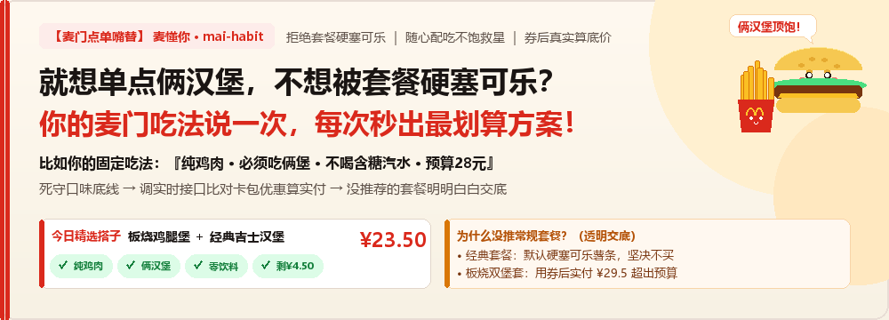
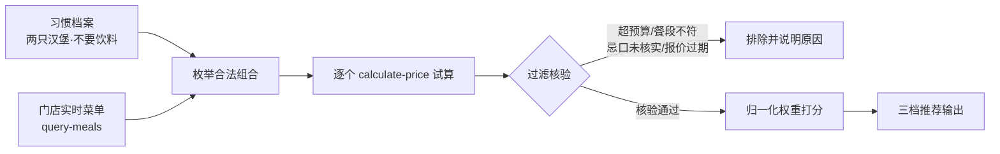

<div align="center">



# 麦懂你 (mai-habit)

**就想单点俩汉堡，不想被套餐硬塞可乐？**  
**你的麦门吃法说一次，每次秒出券后最划算的真省钱方案！**

想吃俩汉堡顶饱、不喝含糖汽水、预算卡死 28 块 —— 这些不是模糊的“猜你喜欢”，而是你每次点餐的硬规矩。

[](https://github.com/pha1aris/mai-habit/actions/workflows/ci.yml)
[](#)
[](#验证)
[](LICENSE)

**[▶ 打开演示页](https://pha1aris.github.io/mai-habit/)** ｜ **[30 秒上手](#三十秒跑起来)** ｜ **[打分机制](#打分怎么来的)** ｜ **[合规边界](#边界)**


</div>

> 上图由 `python habit.py plan` 真实输出渲染，可通过 `tools/render_screenshot.py` 复现校验。

## 解决什么痛点 <a id="给谁用"></a>

适合每次点麦当劳都有固定偏好、却总在几十个餐品与卡包优惠券里反复凑单精算的人。

最接地气的麦门日常痛点：
1. **套餐捆绑难受**：只想单点汉堡大口吃肉，但官方套餐总是默认捆绑大杯可乐或薯条；退订麻烦，不喝扔掉又觉得亏。
2. **随心配吃不饱**：“1+1 随心配”虽是穷鬼福音，但一个汉堡根本吃不饱，点两份又超出预算还硬塞两杯红茶。
3. **卡包优惠算不明白**：卡包里明明躺着一堆满减券、会员日券，自己心算半天，结算时才发现门槛没凑够或者根本没减多少。

麦懂你把你的个人点单习惯（例如：`只要鸡肉 · 必须吃俩堡 · 不喝甜饮料 · 预算28元`）转化为**常驻硬约束**，每次点单直接调用真实试算接口，挑出到手价最低、且最符合你胃口的组合。

## 它和“猜你喜欢”有什么不同

| 维度 | 常规推荐（猜你喜欢） | 麦懂你（麦门硬约束精算） |
|---|---|---|
| **输入依据** | 靠历史点击被动推测（容易推错） | 用户主动声明的麦门硬性习惯 |
| **“想吃俩汉堡”** | 常被当成“偶尔多吃”被忽略 | **硬约束**：仅含单汉堡的方案在枚举第一步就直接淘汰 |
| **“不喝含糖饮料”** | 套餐总把大可乐塞进购物车 | `drink: max=0`，从源头杜绝任何带饮品的组合 |
| **到手价试算** | 拿菜单标价机械相加（脱离卡包实际） | 每套候选单独调用真实试算接口获取**券后实付底价** |
| **推荐透明度** | 算法黑盒，推荐理由含糊其辞 | 完整展示分数明细；**未推荐的套餐逐条列明排除原因（绝不踩坑）** |

## 在线试玩

无需安装任何环境：直接访问在线演示页，左侧微调点餐条件（主食份数、饮品需求、单餐预算、偏好标签），右侧实时查看推荐组合与逐条排除原因。

👉 **[点击打开在线试玩：https://pha1aris.github.io/mai-habit/](https://pha1aris.github.io/mai-habit/)**  
（GitHub Pages 部署；亦可直接在本地浏览器中打开 [`docs/index.html`](docs/index.html)，完全支持离线运行）。

**关键说明：**

- **前后端算法同构**：演示页基于纯原生 JavaScript 实现，其组合枚举规则与打分模型严格对照 Python 核心实现（`planner.py` 与 `recommender.py`）。CI 流水线中的 `demo-parity` 任务会全量交叉比对两端输出，确保逻辑零漂移。
- **计价口径区别**：演示页基于**菜单标价**进行保守估算；而命令行与真实调用则接入 `calculate-price` 接口获取含优惠券的券后实付价。因此同一组合在真实试算下可能更划算，也可能有更多组合得以进入预算范围。**坚决不拿标价简单相加冒充真实应付**，是本项目的底层原则。
- **演示数据说明**：示例中所涉门店、餐品、价格均为脱敏虚构数据，用于展示算法逻辑与交互体验，不代表任何真实麦当劳门店。

## 30 秒快速上手 <a id="三十秒跑起来"></a>

环境要求：Python 3.10+，**零第三方依赖**，无需即刻申请 Token。克隆仓库后进入目录即可运行：

```bash
cd mai-habit

# 1. 快速体验：查看推荐效果（基于内置虚构菜单，无文件副作用）
python habit.py demo

# 2. 初始化你的个人用餐习惯（只需配置一次，后续自动作为默认规则）
python habit.py init
#    一餐要几份主食？[2]
#    要不要搭配饮料？[y/N]
#    这一餐预算多少元？[30]
#    固定的口味偏好（可留空）：

# 3. 运行端到端完整链路：解析菜单 → 枚举合法组合 → 逐一计价试算 → 综合排序
python habit.py plan \
  --profile private/profile.json \
  --menu    examples/replay/menu.json \
  --prices  examples/replay/prices.json \
  --mapping examples/replay/mapping.json \
  --meal lunch --store MCD-DEMO-001
```

> **链路说明**：步骤 3 与接入官方实时服务的执行路径**完全同构**，仅将网络交互替换为本地脱敏回放数据。步骤 2 记录的预算将作为默认预算，后续执行时 `--budget` 可缺省。

**为什么第 2 步建档至关重要？**  
仓库内置的 `examples/profile.json` 仅是展示用的示例（「两只汉堡、不含饮料」），并不代表你真实的饮食偏好。若直接以此计算，输出的将是套用他人条件的“伪推荐”——这正是本项目极力避免的体验。因此示例档案内置 `"source": "example"` 标记，调用时会明确提示，避免误将示例当结论。

**鲁棒性与工程细节：**

- **Windows 控制台编码适配**：原生兼容中文 Windows 控制台（GBK / CP936 编码），重定向到文件输出时自动切换为标准 UTF-8，交互模式下优雅适配货币符号，杜绝编码报错崩溃。
- **文档截图保真校验**：README 首屏的终端效果图（`docs/terminal.svg`）通过 `tools/render_screenshot.py` 由真实命令输出直接渲染，CI 会逐字节比对防漂移，确保文档内容与代码行为绝对一致。

## 内部流程



三大核心工程原则：

1. **前置约束剪枝**：在组合枚举阶段即严格依据习惯规则进行过滤，杜绝先无序穷举再后置剔除的开销，从而最大化节省下游 API 配额。
2. **拒绝标价相加**：单品标价之和不等于含券应付总价。菜单标价仅作为候选池大小的预筛选水位线，真实推荐排序严格以 `calculate-price` 接口的应付总价为准。
3. **时效性硬失效机制**：计价报价严格限制 15 分钟有效期。过期直接中断并提示重新试算，坚决不用陈旧报价误导决策。

## API 调用预算与频控保护

在零依赖约束下，对网络调用保持克制。实时模式下，单次 `plan` 流程的总请求量精准控制在 **N + 3** 次（而非冗余的 `2N + 3`）：

| 流程环节 | 请求次数 | 说明 |
|---|---|---|
| MCP 协议握手 | 2 | `initialize` 与 `notifications/initialized` 阶段 |
| 工具元数据发现 | 1 | `tools/list` 在客户端会话内全局缓存，避免重复拉取 |
| 组合精确计价 | N | 针对 N 个合规候选分别发起单次 `calculate-price` 试算 |

> 早期实现中若每次 `tools/call` 都重复请求 `tools/list` 提取 `inputSchema`，40 个候选将产生 40 次冗余查询。现已在 Client 内部实现工具目录缓存，会话生命周期内单次获取，按需刷新。

**频控与容灾策略：**

- **单连接串行试算**：摒弃无序的高并发请求，防止触发开放平台的突发并发限流导致全流程中断。
- **试算水位管控（`--max-quotes`）**：默认上限 40 次，超出截断时在输出中明确提示跳过数量，绝不静默丢弃。
- **自适应指数退避**：遭遇 429 或 5xx 时自动执行最多 2 次有限重试，严格遵守服务端的 `Retry-After` 响应头；且重试仅局限于只读探测，彻底杜绝副作用风险。

## 评分机制与动态权重 <a id="打分怎么来的"></a>

基准打分模型定义为：

```text
综合得分 = 70 × 口味标签匹配度 + 20 × 历史反馈平滑倾向 + 10 × 预算余量比例
```

**拒绝伪个性化：缺失证据的维度自动剔除，剩余维度权重归一化到 100%：**

| 个人档案画像状态 | 实际生效权重分配 | 排序逻辑实质 |
|---|---|---|
| 仅声明基础组成（如：两只汉堡、不要饮料） | 预算 100% | 纯价格最优优先（最低成本满足吃法） |
| 追加口味倾向（如：偏好鸡肉、不吃辣） | 口味 87.5% + 预算 12.5% | 优先匹配偏好标签，同分下价格优先 |
| 持续沉淀反馈（有点赞 / 不喜欢历史） | 口味 70% + 反馈 20% + 预算 10% | 综合考量偏好倾向与性价比，动态进化 |

> **设计内幕**：很多推荐系统在冷启动阶段仍保留虚高的“偏好权重”，即便其计算结果恒等于 0，仍冠以“专属推荐”的名号包装价格排序。麦懂你拒绝此类包装：无口味沉淀时，输出会开诚布公地标注「当前没有口味偏好记录，仅按预算排序」。  
> 类似地，`最合口味` 标识仅在真正命中偏好标签时赋予；若所有合口味组合均超预算，系统会明确降级为 `预算内可选`，绝不含糊其辞。

## 边界诚实：清晰透明的排除理由

当预算收紧至 25 元，导致偏好的纯鸡肉组合全部超出预算范围时：

```text
## 预算内可选：吉士汉堡×2

吉士汉堡 × 2

合计 ¥19.00，预算余量 ¥6.00。
偏好匹配：无明确偏好命中；历史反馈倾向：+0.00；综合分：2.40。

## 排除原因

- 板烧鸡腿堡×2：超预算 ¥4.50（合计 ¥29.50）
- 板烧鸡腿堡×1＋麦辣鸡腿堡×1：超预算 ¥4.50（合计 ¥29.50）
```

系统**绝不妥协硬性条件**：不会私自将“两只汉堡”缩减为一只，不会擅自把饮料重新塞入组合，更不会掩盖超额事实把违规候选混充进推荐名单。

## 它是怎么记住习惯的

首要原则是主动询问，而非被动盲猜。`init` 引导你逐项明确组成构件、预算上限、口味偏好与忌口原料，并安全保存至本地私有档案：

```bash
# 交互引导模式：逐项确认，回车即采用推荐默认值
python habit.py init

# 参数静默模式：面向智能体调用或自动化脚本
python habit.py init --burger 2 --drink none --budget 25 --tags chicken,non_spicy
```

生成的本地画像样例（`private/profile.json`）：

```json
{
  "source": "user",
  "created_at": "2026-10-24T10:55:17+08:00",
  "category_limits": {
    "burger": {"min": 2, "max": 2},
    "drink":  {"max": 0}
  },
  "preferred_tags": ["chicken"],
  "avoid_tags": [],
  "feedback": {},
  "default_budget_cents": 2500
}
```

之后仅在用户**明确给出评价反馈**时才递增记录：

```bash
# 仅在用户主动表达“今天这个板烧味道不错”后，才录入反馈倾向
python habit.py feedback --profile private/profile.json --meal lunch --tags chicken,non_spicy --rating like
```

**关键设计：**

- **`source` 区分用户意图与演示模板**：`user` 表示经确认的真实偏好，`example` 运行时则会触发提醒；缺少该字段的档案一律按示例隔离对待。
- **防意外覆盖**：`init` 默认禁止覆盖已有档案，强制覆盖需显式指定 `--force`。档案保存在 `private/` 目录，权限设为 600。
- **餐段上下文隔离**：反馈数据按 `breakfast / lunch / dinner` 独立分立统计，早餐习惯不干扰正餐决策。
- **“曾被推荐”绝不等于“吃过满意”**：仅在用户显式点赞或标记不满意时才计入历史反馈。
- **透明可控**：档案采用纯净、明文的 JSON 文件存储于本地，可随时自由查看、修改或彻底删除。

## 接入麦当劳官方 MCP

前往[麦当劳 MCP 开放平台](https://open.mcd.cn/mcp)申请访问凭据，置于本地环境变量（注意：严禁将密钥明文写入代码、截图或公共仓库）：

```bash
export MCD_MCP_TOKEN='<your-token>'
python habit.py mcp-tools     # 探测服务端实际开放的工具列表与 inputSchema
```

配置好字段映射表后，省略 `--prices` 即可直接进入实时在线模式：

```bash
python habit.py plan \
  --profile private/profile.json \
  --menu    private/menu-response.json \
  --mapping private/mapping.json \
  --meal lunch --budget 30 --store <门店编号>
```

### 为什么设计独立的 Mapping 映射配置？

**这是本项目的重要技术权衡：坚决不隐式猜测 API 数据结构。**

下游 MCP 服务的返回结构可能随版本迭代升级。与其硬编码一套缺乏依据的字段命名、在字段变更时引发难以排查的暗默计算错误，不如通过声明式的 mapping 文件将结构映射外置：一旦数据格式不符立即明晰报错。

```json
{
  "menu": {
    "list": "categories.*.items.*",
    "price_unit": "yuan",
    "fields": {
      "code": "productCode", "name": "productName",
      "category": "categoryName", "price": "price",
      "tags": "tasteTags", "available": "saleStatus"
    }
  },
  "price_request": {
    "storeCode": "${store_id}",
    "items": "${items}",
    "itemTemplate": {"productCode": "${code}", "quantity": "${quantity}"}
  },
  "quote": {"total_cents": "payPrice"}
}
```

- `categories.*.items.*` —— 点路径表达，`*` 语法展开嵌套数组。
- `${...}` —— 计价请求模板占位符，支持保留原 JSON 数据结构。
- 中文类目名（汉堡 / 饮料 / 小食）会自动归一化映射为内部标号 `burger / drink / side`。

## 数据真实性与验证范围声明

公开透明地说明测试环境与验证边界：

- `examples/replay/*` 所包含的门店编号、餐品编码及标价均为**脱敏与虚构样本**，不代表麦当劳线上真实数据。
- 本项目目前在开发阶段**尚未绑定真实生产 Token 完成生产环境联调**，演示中的价格数据不可直接作为真实线下就餐消费的参考依据。
- **协议与链路已完全就绪**：MCP 通信协议链已在代码层完整落地并获高覆盖率单元测试保障（覆盖握手协议、工具自动发现与分页、JSON/SSE 混合响应流、只读白名单拦截、按动态 `inputSchema` 强校验）。
- **验证结论的定位**：当前演示充分证明了**业务逻辑的严密性、工程链路的完整性与算法的可复现性**，但在完成官方线上真实联调前，不宣称代表任何真实门店在特定时刻的实际出票价格。

## 安全与合规边界 <a id="边界"></a>

- **严格只读策略**：客户端层内置白名单，仅放行 8 个只读查询与计价接口；对于 `create-order`、`cancel-order`、`auto-bind-coupons` 等任何写操作，在代码底层无条件拒绝。该白名单作为最高安全策略，在凭据校验前即生效拦截。
- **杜绝灰色代下单与卡券套利**：不收购、不转卖、不提供代下单服务，严格仅调用官方标准试算能力，守护用户资金安全。
- **食品安全忌口零推测**：若用户档案包含忌口标签（`avoid_tags`），必须显式通过 `--checked-avoid` 确认已核对的原料范围，否则系统宁可拒绝执行，绝不擅自揣度食材成分。
- **预算不足时的建设性反馈**：若当前预算无法满足既定习惯，系统不会简单抛出“无候选”，而是精确测算并告知“按此饮食习惯的最底线起步金额”（并清晰注明估算口径），仅建议调整预算变量，坚决不擅自更改用餐习惯与忌口约束。
- **局部最优透明性**：系统如实提示推荐结果局限于当前成功枚举且完成试算的候选集，不虚假声称覆盖全门店全局最优。
- **免责声明**：项目提供之组合与估算不构成任何医疗或营养学建议；餐品库存、最终实付价格及优惠有效性均以麦当劳官方收银终端结算为准。

## 文件结构

```text
habit.py                         命令行入口
skills/mai-habit/
  SKILL.md                       智能体可直接加载的 Skill 规范文档
  scripts/main.py                init / demo / plan / recommend / feedback / mcp-* 命令实现
  scripts/planner.py             按习惯枚举组合（同品多份、分类数量上下限剪枝）
  scripts/adapter.py             MCP 响应 → 内部契约映射（声明式映射，拒绝隐式猜测）
  scripts/recommender.py         规则过滤、动态归一化权重打分、可解释性输出
  scripts/mcp_client.py          Streamable HTTP 客户端，支持 JSON 与 SSE，内置缓存与指数退避重试
  scripts/console.py             Windows 控制台编码自愈（GBK/CP936 兼容与标准重定向）
examples/
  profile.json                   冷启动基础档案（纯习惯约束）
  profile.demo.json              全功能演示档案（含口味偏好与历史反馈）
  catalog.demo.json              内置静态演示候选集
  replay/                        脱敏回放样本，支持零 Token 验证全链路
tests/                           87 项单元测试（覆盖对外行为契约与演示页双向保真）
tools/render_screenshot.py       将真实命令输出渲染为 README 终端 SVG 截图（CI 自动校验）
tools/verify_demo_parity.py      跨语言比对浏览器与命令行枚举结果（CI 门禁卡口）
docs/index.html                  在线试玩演示页，纯前端、零依赖、支持完全离线运行
docs/terminal.svg                README 首屏真实终端渲染图
.github/workflows/ci.yml         多 Python 版本矩阵 + 冒烟验证 + 截图保真 + 枚举一致性 CI 流水线
```

## 自动化测试与验证体系 <a id="验证"></a>

```bash
python -m unittest discover -s tests -v
```

测试覆盖完整业务场景：用餐习惯建档（交互式/非交互式校验、默认值继承、防覆盖保护、示例标记警示）、组合约束剪枝枚举、分类数量上下限、预算边界与优惠余量、报价时效性硬失效、门店与餐段上下文校验、忌口原料安全边界、餐段隔离的动态反馈演进、权重自适应归一化、MCP JSON/SSE 握手通信、流式游标分页、只读操作白名单防御、工具元数据生命周期缓存、429/5xx 指数退避与 `Retry-After` 头解析、全链路脱敏回放比对、映射异常聚合诊断、Windows GBK/CP936 终端编码自愈。

- **对外行为契约保障**（`tests/test_contract.py`）：黑盒校验 `SKILL.md` 对外承诺的核心行为，脱离内部实现干扰：包含在未配置 Token 时写操作仍先被白名单策略拒绝、可用只读工具在缺失 Token 时准确提示鉴权异常、预算不足时准确计算底线门槛且绝不放宽饮食习惯、截断指标与脱敏标记真实呈现等。
- **演示页与核心逻辑保真验证**（`tests/test_demo.py` & `tools/verify_demo_parity.py`）：确保 Web 演示页与底层 Python 算法绝对同构：菜单数据逐项一致、计价口径清晰标注标价估算、虚构数据提示置顶展示、杜绝开发占位符遗留；并通过 Node.js 跨语言全量比对三种典型饮食习惯结构下的全部枚举组合，纳入 CI 门禁强卡口。

## 关于本仓库

- 麦当劳程序员节创意开发大赛参赛作品，由参赛者独立开发，**非麦当劳官方产品**。
- 参赛声明参见 [CONTEST_DECLARATION.md](CONTEST_DECLARATION.md)，MCP 集成细节参见 [MCP_INTEGRATION.md](MCP_INTEGRATION.md)，报名材料参见 [SUBMISSION.md](SUBMISSION.md)。
- 原创开源代码采用 [MIT 许可证](LICENSE)。参赛声明官方原文、麦当劳服务与商业标识均不在本项目开源授权范围内。
